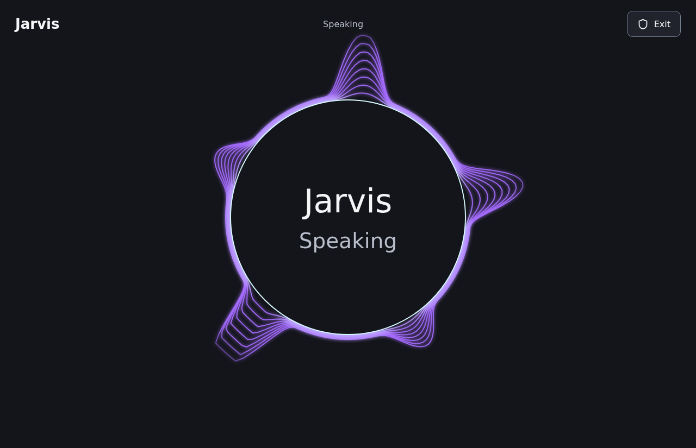
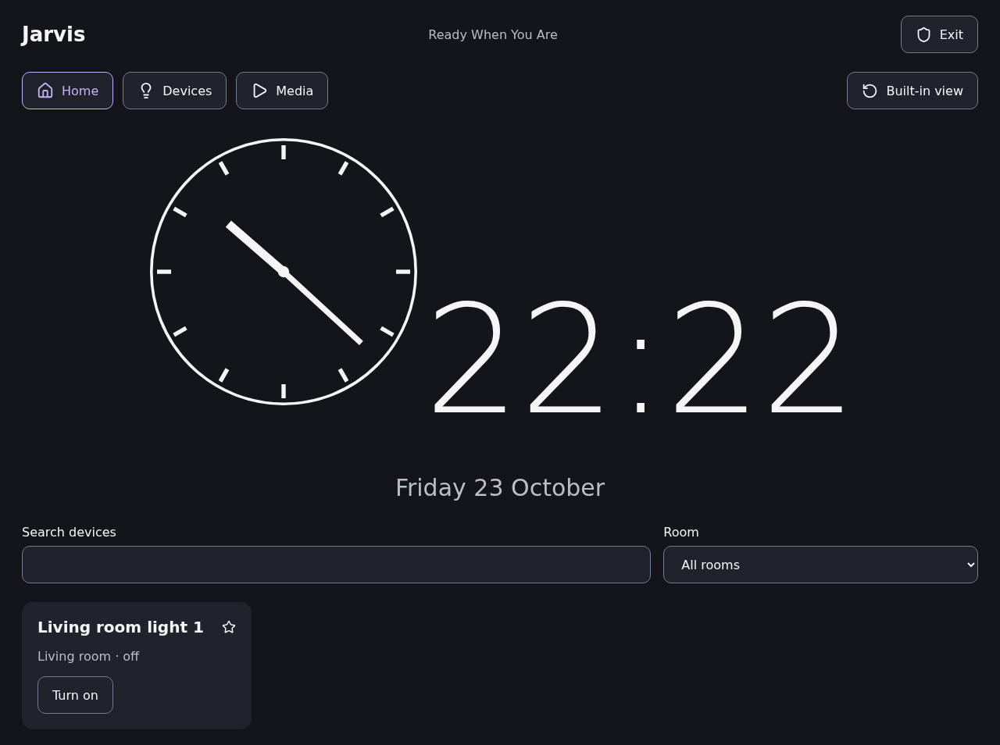
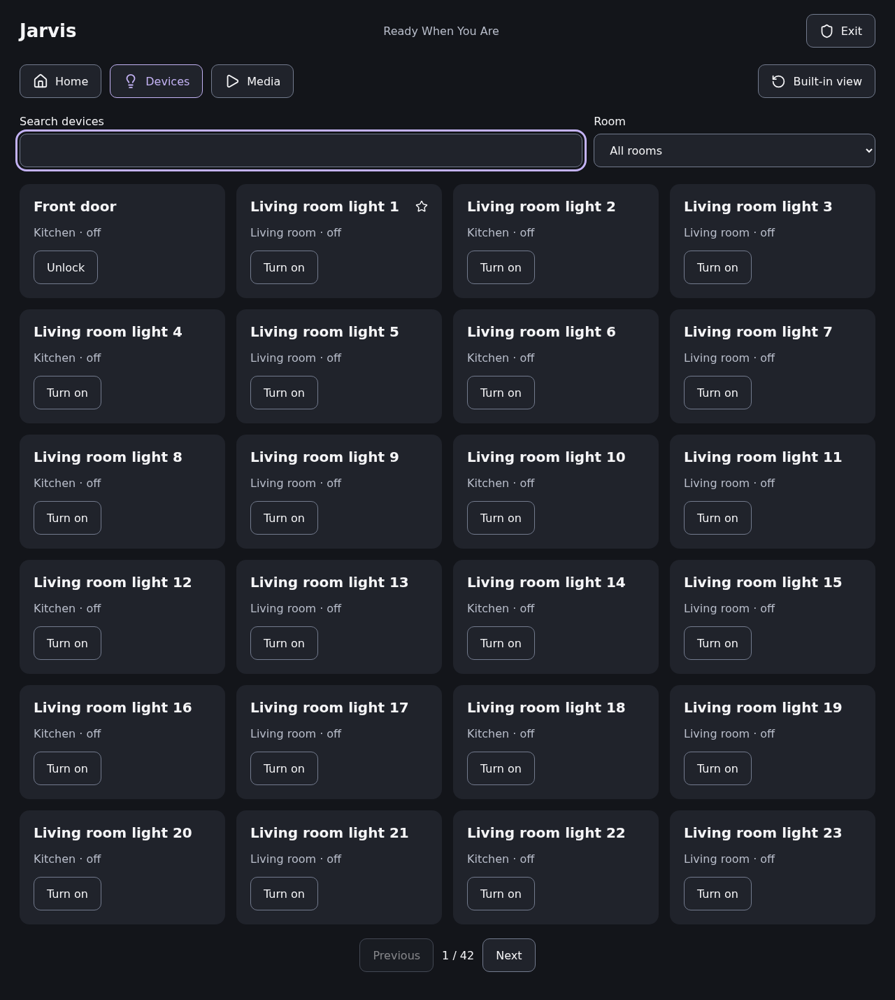
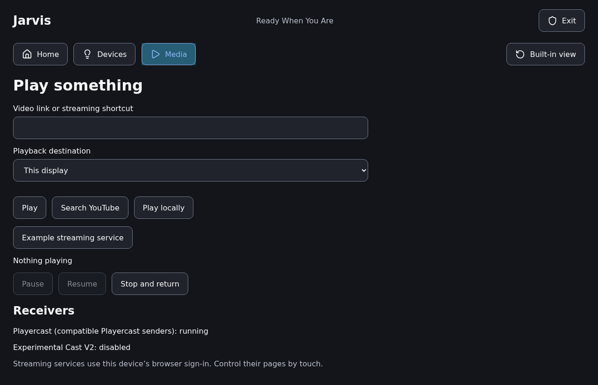
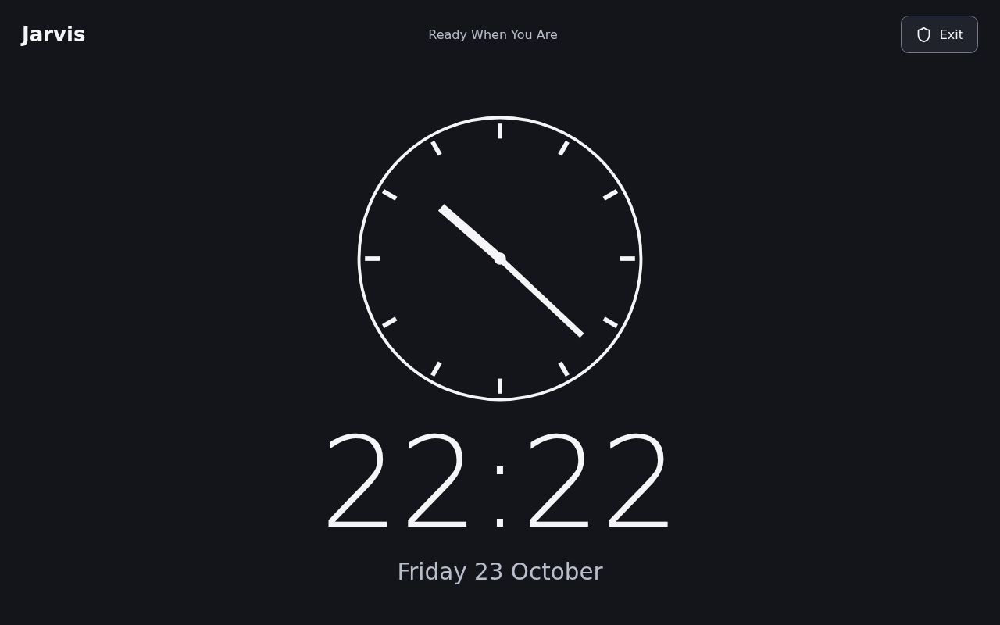
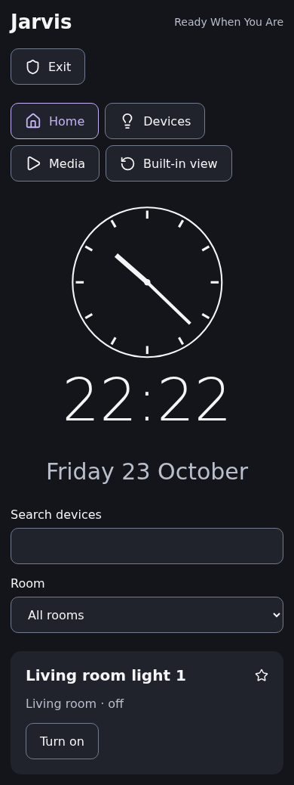
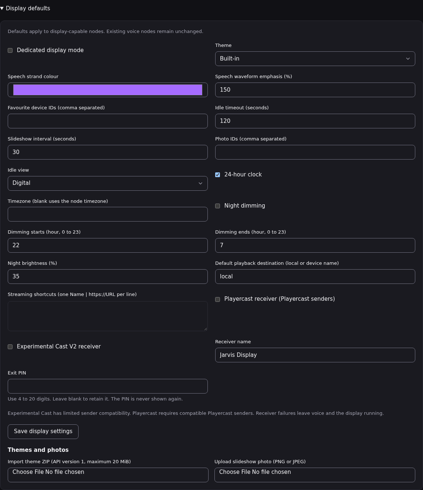
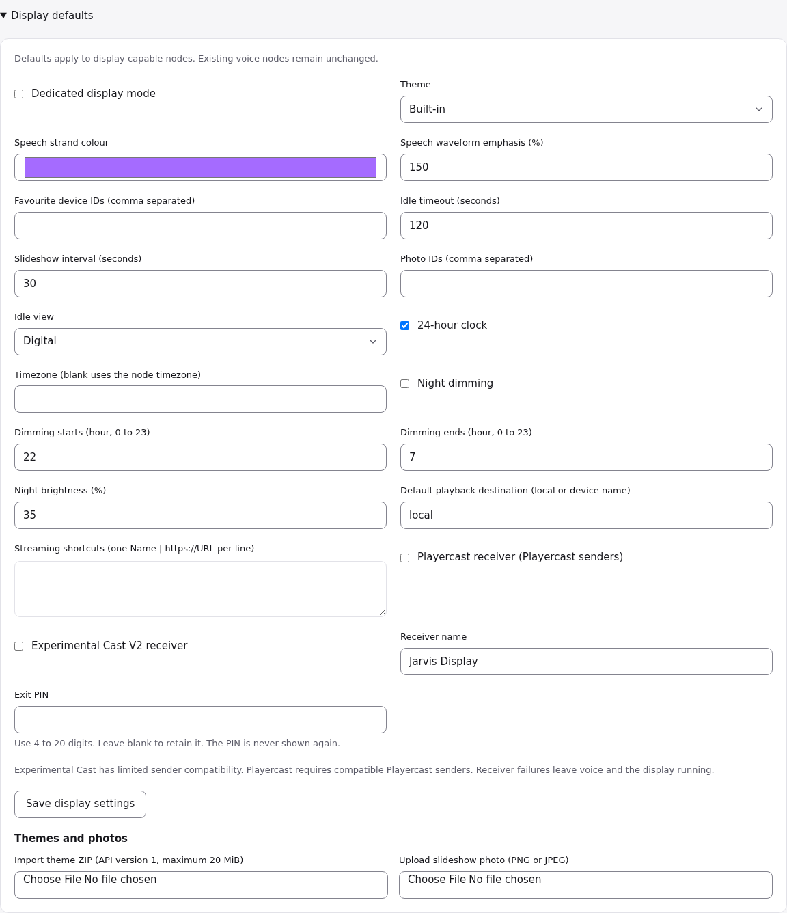
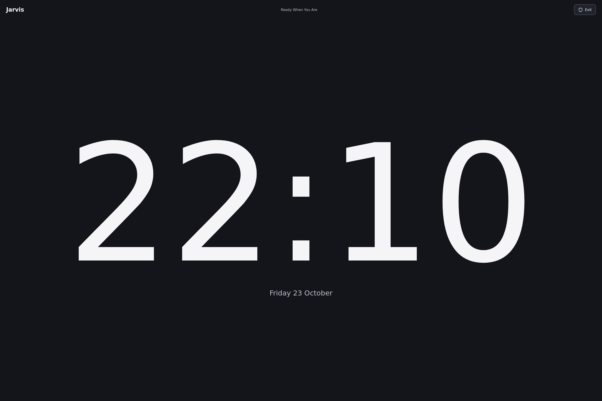
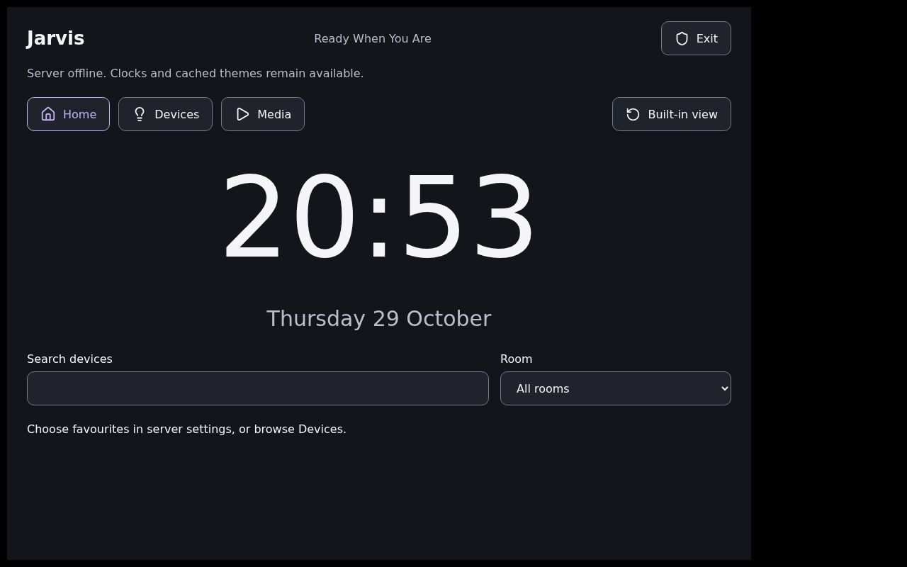

# Use the Jarvis touch display

The Linux agent offers a local touch display on any device with a screen when started with
`run --display`. It is not tied to one model of hardware. Other agents and nodes retain their existing
behaviour. Build the React assets before building both Go binaries:
`npm ci && npm run build` in `web/admin`, then the usual `CGO_ENABLED=0 go build` commands. The agent
embeds the installed display assets, so the shell, clocks, photos and themes work without the server.

## Requirements

- Linux, with a graphical session whose `DISPLAY` is visible to the agent. The agent reports
  "Waiting for a desktop session" until one exists, so start it from the session (or import the
  session environment into its service). Wayland-only sessions without XWayland are not covered.
- `chromium` and `mpv` on the `PATH`, and a screen. The shell is built for touch.
- The server's `/api/v0/node/display` endpoints, which the node reaches with its existing credentials.

Tested hardware: a Surface Pro 6 (x86-64) with a real touchscreen, see the pilot notes below, and a
Raspberry Pi 3 Model B (aarch64, Debian 13) under a virtual display (Xvfb with the Openbox window manager). On the
Pi, `go test` for the display packages passes natively, and the engine serves the shell and starts the dedicated
Chromium window, which fills the 1280x800 screen. Driving the real UI with `xdotool` mouse and keyboard events, the
Home, Devices and Media views open, a wrong exit PIN is rejected ("Incorrect PIN") and the right PIN closes Chromium
([Home](touch-display-screenshots/raspberry-pi-3b-arm64.png), [Devices](touch-display-screenshots/raspberry-pi-3b-devices.png),
[PIN exit](touch-display-screenshots/raspberry-pi-3b-pin-exit.png)). Chromium used roughly 200 MB of the Pi's 905 MB of
RAM. This ran offline, with no `jarvisd`, so server-delivered configuration was not exercised on the Pi. Not tried on a
Pi: a physical screen, touch input, or `--profile pi` together with `--display` (the Pi profile is headless by default).

## Configure and enable

As a superuser, open **Settings > Display defaults**. Set a numeric exit PIN with **4 to 20 digits**,
then save. This replaces the original plan's six-digit requirement at the user's request on 20261023.
Under **Nodes > your display node > Display settings**, enable dedicated display mode and save.
The node must be running the new agent with `--display` before these controls appear.

Every field can inherit the server default. **Use server default** removes that field's override.
An empty override object inherits everything. The built-in values are a digital clock, 120 seconds
before idle, 30 seconds per slideshow photo, the node's timezone, local playback and no night dimming.
Playercast and experimental Cast start disabled. Favourites use catalogue device IDs; the node editor
also offers a named device checklist when its household has imported devices.

Saved and applied revisions are separate. An online node receives a nudge and polls every 30 seconds;
it also synchronises after MQTT reconnect. It downloads and checks every assigned asset before
atomically replacing its private last-good configuration. A failed download keeps the previous
configuration. Receivers report their own availability without stopping voice or the touch shell.

Server endpoints are `/cc/api/v0/display/config/{scope}` (`defaults` or a node ID), and
`/cc/api/v0/display/assets`. Administrative access requires a superuser at both the admin gateway
and command-center. The node uses its existing credential for `/cc/api/v0/node/display`, its
acknowledgement, assigned assets, device queries and media routing. Configuration and asset tables
are additive cc migration **00320**.

## Touch and voice

Home shows the clock and favourites. Devices provides room filtering, search and pages of 24 devices.
State requests are bounded to four workers. Failed requests preserve the last confirmed state and
show the failure. The server scopes each request to the enrolled desktop owner's current household
membership, checks the catalogue's permitted action and refuses identity or routing fields in data.
Unlocking or opening an access device requires confirmation in the trusted shell.

The circular speech waveform uses live voice RMS samples delivered over a local authenticated event
stream, 20 times per second. It shows amplitude-driven radial flares around a fixed circle while Jarvis speaks;
it is not a frequency spectrum. Peaks burst outwards at fixed angles and never travel around the
ring. The idle clock uses a 75% display area and the Home clock is 50% larger than its original size. The circle fills the display during replies, with the trusted
exit control still visible. Configure **Speech strand colour** and **Speech waveform emphasis (%)**
in display defaults or override either field per node. Emphasis accepts 25 to 200%, defaults to
150%, and colour accepts `#RRGGBB`. **Use server default** restores inheritance. The JSON fields
are `waveform_colour` and `waveform_emphasis`; both are omitted when absent in older cached
configurations so their revision checks remain valid. Reduced-motion preference produces a static indicator. The shell
keeps this indicator and recovery/exit controls outside theme code. Controllable mpv playback pauses
for voice, the shell comes forward where X11 window control is available, and playback resumes
only if it was playing before the interaction. Streaming websites remain under touch control.

The dedicated Chromium profile starts full-screen with `--password-store=basic` to avoid a login
keyring prompt in auto-login accounts. This profile is local-only and must never be used for website
credentials. Streaming sites retain a separate profile with normal credential storage and may ask
for a keyring password on first sign-in. See [Chromium password storage](https://chromium.googlesource.com/chromium/src/+/HEAD/docs/linux/password_storage.md).
The desktop environment's own shortcuts remain available. PIN exit closes the display, its media and receivers, leaving
the agent's voice service running. Five failed attempts impose a
one-minute delay. The salted bcrypt verifier is delivered only to the authenticated node and stored
in its private configuration cache with mode `0600`. Neither settings reads nor the shell/theme API
returns the PIN or verifier.

## Media and receivers

`display_media` is a client tool with `action` (`play`, `pause`, `resume`, `seek`, `stop`, `status`),
`url`, `query`, `destination` and `seconds`. An omitted destination uses the node's effective
configuration. `local` means this display. A named household Home Assistant media player overrides
it. External routing uses the existing node/plugin relay and the installed Home Assistant plugin,
checks its advertised media feature flags and returns errors for unavailable or unsupported targets.
That relay node also needs the updated agent. Nothing in the frontend connects directly to HA.

Direct HTTP(S) media links and regular files under the kiosk user's `~/Videos` use mpv. Symlinks
outside that directory, other local paths and non-web URL schemes are rejected. YouTube URLs and
YouTube searches open Chromium. Streaming shortcuts accept names and HTTP(S) URLs, opening a
separate persistent browser profile for touch navigation and local sign-in. Programme search and
automatic subscription playback are outside this version. External destinations require direct media
links; **Play locally** remains available after a routing error.

Install mpv and Chromium. Install [Playercast](https://github.com/Rafostar/playercast) for reception
from compatible Playercast senders. Install [openchromecast](https://github.com/yukarikaname/openchromecast)
for separately enabled experimental Cast V2 reception. On Debian the tested openchromecast package
also needed `libxdo3`. This is a software flinging receiver; stock Google applications can reject its
certificate. Screen mirroring and universal Chromecast compatibility are not provided.

The agent supervises the two receivers independently. A private mpv wrapper shares their existing
IPC sockets with the playback and voice lifecycle. Neither receiver receives Jarvis node credentials.
The display browser blocks external requests through a loopback-only proxy bypass; streaming sites
use a separate browser profile. Network isolation is enforced by the installed browser launch as
well as theme CSP. Never launch the display profile with its proxy restrictions removed.

## Themes

Import `themes/starter.zip` through the asset controls, preview it, choose it and save. Export
returns the original ZIP. A theme still assigned in defaults or any node cannot be deleted. Choose
**Built-in** and save for a remote reset, or use **Built-in view** locally for immediate recovery.
Missing assets, an iframe load error or no `ready` message within five seconds keeps the built-in
view available. The trusted Home, Devices, Media and recovery controls stay outside the iframe.

A version 1 ZIP has `manifest.json` at its root, with this manifest:

```json
{"api_version":1,"name":"My display","entry":"index.html"}
```

Include HTML, CSS, JavaScript and local assets. Paths must be relative and normalised: no absolute
paths, backslashes, traversal, duplicate files or symlinks. There are at most 256 entries and 20 MiB
of compressed and expanded data. Photos accept PNG or JPEG with at most 24 million pixels.
The administrative preview inlines local scripts, styles and images. The agent serves the original
files; use the live display to check module-based themes and complex CSS imports.

Themes run in an iframe with `sandbox="allow-scripts"`, without same-origin, top-level navigation, forms or
native privileges. They use `parent.postMessage(message, '*')`; check `event.source === parent`
and `event.data.api_version === 1` when receiving. Messages are:

| Direction      | Type              | Data                                                         |
| -------------- | ----------------- | ------------------------------------------------------------ |
| Theme to shell | `ready`           | Sent after installing the message listener                    |
| Theme to shell | `activity`        | Touch or keyboard activity, to reset the idle timer            |
| Theme to shell | `device.action`   | `request_id`, `device_id`, `action`, optional scalar `data`     |
| Theme to shell | `media.control`   | `request_id`, `action`, optional `url`, `query`, `destination`, `seconds` |
| Shell to theme | `state`           | Device summaries, clock timestamp/timezone, display and media  |
| Shell to theme | `voice`           | `voice` and `level`, with normalised RMS amplitude              |
| Shell to theme | `result`          | `request_id`, `result` containing success or an error           |

The shell checks the source frame and opaque origin, validates actions and handles access-device
confirmation itself. The server repeats household and action validation. There is no theme API
for credentials, exit verification, files, processes or server administration. Preview uses synthetic
device state and cannot execute device actions.

## Verification

Run `scripts/check` and `CGO_ENABLED=1 go test -race ./...` with the SDK installed in the Python
selected by `JARVIS_SIDECAR_PYTHON`. Run `npm test` and `npm run build` in `web/admin`.
After installing `e2e/web` dependencies, `node scripts/display-browser-check.mjs /path/to/results`
checks touch navigation, access confirmation, a 1,000-device catalogue, visible target sizes and
horizontal overflow in landscape, portrait and phone viewports. It writes screenshots and JSON.
Hardware, receiver sender compatibility and subscription sign-in require their own recorded results;
passing these checks alone does not establish compatibility with a phone application or website.

The pilot device, a Surface Pro 6, required the linux-surface kernel and `iptsd`; the stock Debian kernel did
not expose its Intel touchscreen. The original kernel remains available for rollback. After reboot,
the user confirmed finger navigation, the full-screen speech circle and PIN exit with voice
continuing. This hardware acceptance does not establish subscription or stock Cast sender support.

## Screenshots

Captured from the rendered touch shell and admin pages, and from the Surface itself. Files are in
[touch-display-screenshots](touch-display-screenshots/).

| Speech                                              | Home                                          | Devices                                           |
| --------------------------------------------------- | --------------------------------------------- | ------------------------------------------------- |
|  |  |  |

| Media                                             | Idle clocks                                            | Phone width                                        |
| ------------------------------------------------- | ------------------------------------------------------ | -------------------------------------------------- |
|  |  |  |

| Settings, dark                                          | Settings, light                                          | On the Surface                                      |
| ------------------------------------------------------- | -------------------------------------------------------- | --------------------------------------------------- |
|  |  |  |

| Raspberry Pi 3B (aarch64, virtual display) |
| ------------------------------------------ |
|  |
