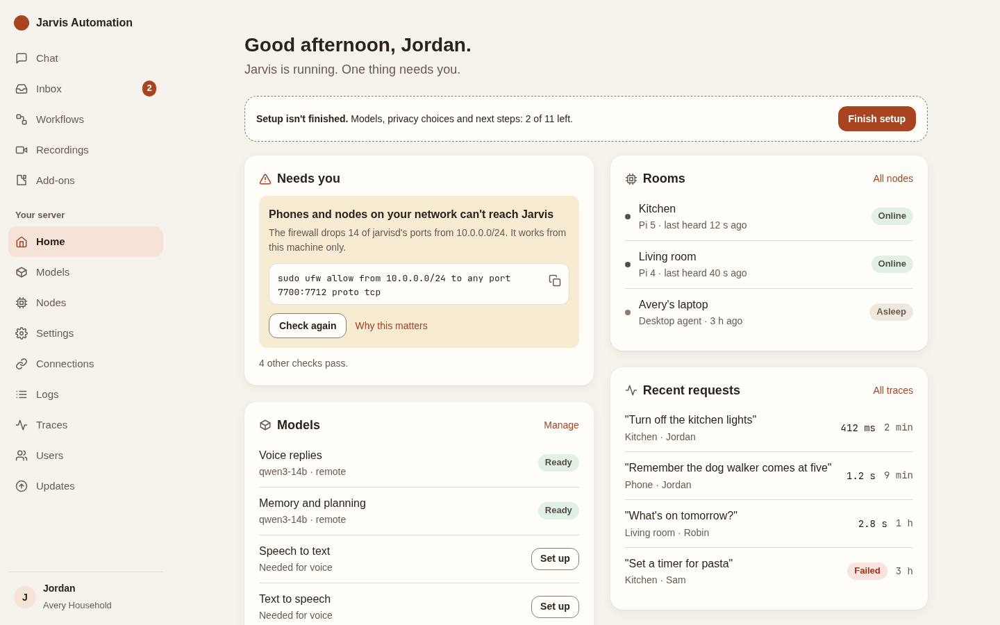
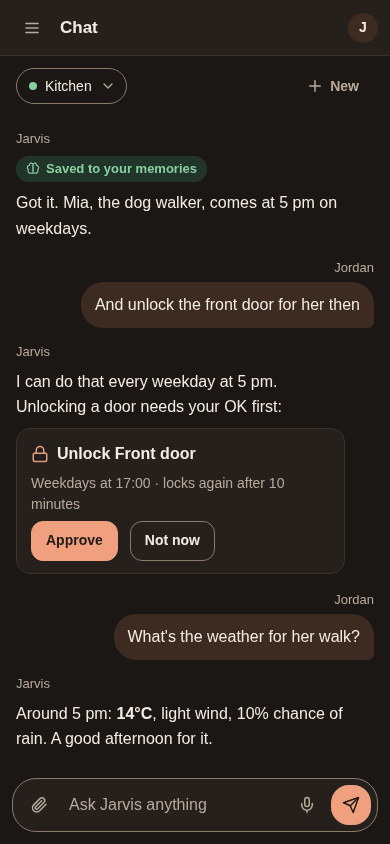
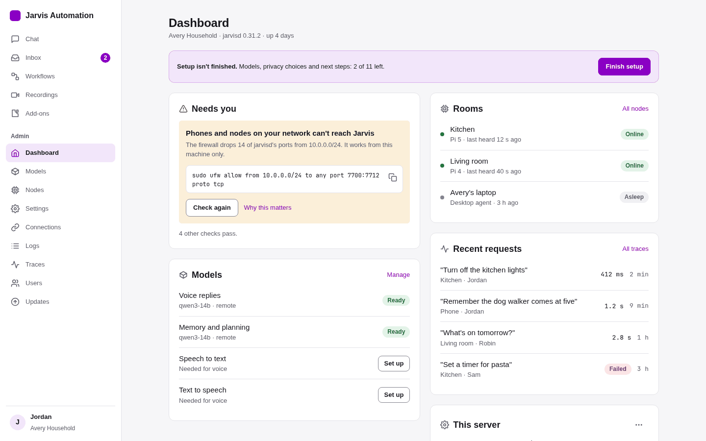
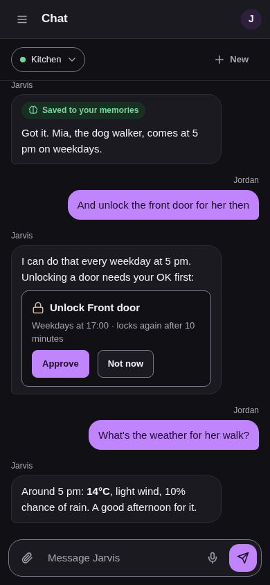
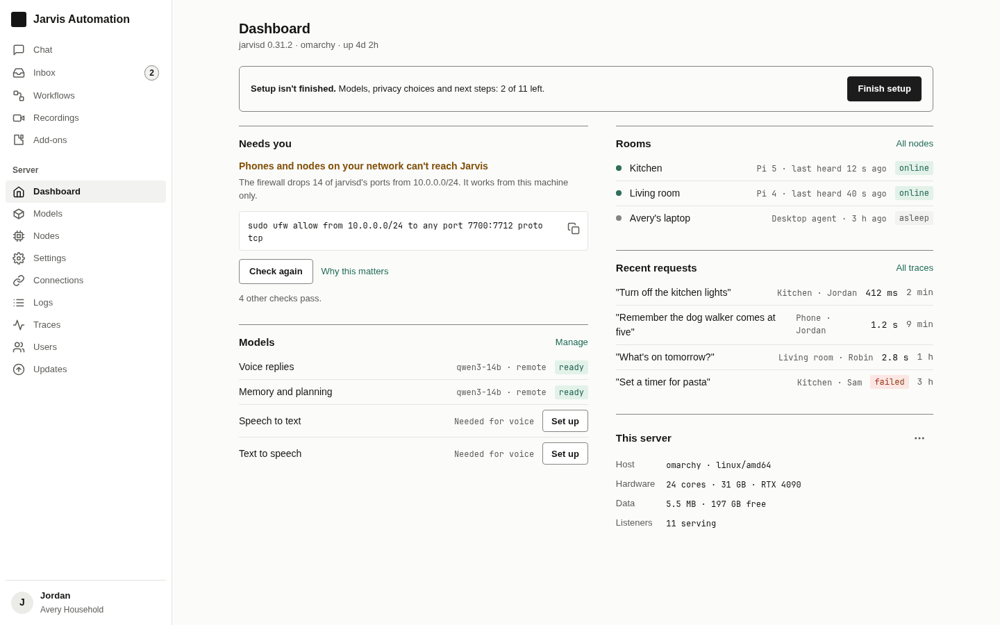
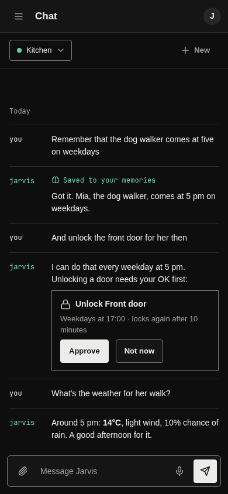

# Design audit of the web UI, October 2026 (#331)

What is wrong with the look and feel of the admin/member web app, the desktop agent's first-run page
and the browser extension's popup, ranked, with screenshots; then three visual directions for the
user to choose from. **Nothing under `web/admin/src/` changes here**: the overhaul items wait on the
choice.

Method: the design skills from #330 (`design-skills/`), in their precedence (accessibility first,
then Impeccable's system rules, Emil for motion, Taste for layout at variance 3 / motion 2 /
density 5). Impeccable's `audit.md` gives the scored report; Emil's review is the Before/After table
it requires; Taste's review is the layout and states section.

- **Compare the directions:** [`directions/directions.html`](directions/directions.html) (one
  self-contained page, opens offline; Light/Dark toggle for the mockups). PNGs of each mockup are in
  [`directions/png/`](directions/png/), contrast tables in [`directions/contrast.md`](directions/contrast.md).
- **Screenshots:** a curated, compressed subset in [`shots/`](shots/) (41 files, about 1 MB). The
  full set (every page × phone 390 / tablet 820 / desktop 1440 × light / dark, superuser and
  member) is in the PR's evidence, not the repo.

## How it was captured

| What | How | Shots |
|---|---|---|
| Every SPA page, superuser | `scripts/sandbox up --profile rich --llm scripted --ui`, then `scripts/screenshots --tiles 2000 --pages <all slugs>,/inbox/<id>,/workflows/tw_5eed000000000001` (three inbox items posted first as a service would) | 128 + tiles |
| Member view (Sam) | `scripts/screenshots --user member` | 36 |
| Empty states | a `--profile minimal` sandbox: chat, inbox, workflows, recordings, traces, add-ons | 36 |
| First-run setup wizard | a `--profile empty` sandbox, `/setup#token=…` (Playwright, all 3 widths × 2 themes) | 12 |
| Chat with a thread | two turns against the scripted model (`e2e/llm/web.json`) | 6 |
| Loading and error states | dashboard, inbox, workflows, nodes with every `/api` call held (loading) or answered 500 (error) | 48 |
| Desktop agent first-run | `internal/agent/firstrun/assets/` served as-is with `/api/state` and `/api/servers` stubbed: searching, servers found, pairing code, joined (desktop 1280 + phone 390, both themes) | 10 |
| Extension popup | `popup.html?state=…` with `chrome.permissions` / `chrome.tabs` stubbed: connected, connected without website access, not installed, not connected, both themes | 8 |

`index.json` across the 200 SPA shots: **no horizontal overflow at any width, no console errors**
on the rich sandbox (the minimal one logs a 500 from `chat/warmup`, which is that sandbox having no
model, not a bug). Truncation only where it is intended (long inbox titles, trace rows).

Not captured: hover and keyboard-focus states (checked in code below), toasts, the open nav drawer's
motion, real touch feel, and the agent's tray/island (that is `scripts/desktop-shot`'s job and was
not in the ask).

## Audit health score (Impeccable `audit.md`)

| # | Dimension | Score | Key finding |
|---|---|---|---|
| 1 | Accessibility | 2 | Status colours fail AA as text (`text-red-500` 3.76:1 on white, amber/green 3.2-3.3:1); no `focus-visible` style anywhere; no reduced-motion handling; dark primary buttons are white on #c084fc (2.64:1) |
| 2 | Performance | 3 | One 1.19 MB JS chunk (356 kB gzip; Vite warns); nothing expensive animates |
| 3 | Theming | 2 | Tokens exist and are used 933 times, but there are no status tokens, so 225 raw Tailwind palette classes in 51 files; `theme/colors.ts` is unused and disagrees with `index.css`; three surfaces, three accent colours |
| 4 | Responsive | 3 | No overflow anywhere and a 40 px touch floor; but phone pages are long desktop stacks (Models 7,957 px tall, the wizard's 11 step dots fill the width) |
| 5 | Implementation integrity | 2 | No shared Button / Card / Chip / Field / Empty / Error components: 3 card recipes, 5 primary-button sizes, 4 page-title sizes, emoji as icons, 10-11 px text |
| | **Total** | **12/20** | **Acceptable: significant work needed** |

**Implementation integrity verdict: fail, but a cheap one to fix.** The app has the bones of a
system (nine colour variables per theme, the system font stack, lucide icons only, one layout
shell), and it looks tidy page by page. It is not a system yet: every page re-types its own buttons,
cards, chips and error lines from Tailwind classes, so they drift, and anything the tokens don't
cover (status, emphasis, elevation) is a raw palette class. None of the craft-floor bans appear (no
gradients, glows, side-tab accents, eyebrows or bounce easing).

## The problems, ranked

Severity is Impeccable's: P1 = WCAG AA failure or significant difficulty, P2 = annoyance with a
workaround, P3 = polish. Nothing is P0: every task can be completed.

### 1. [P1] Error, warning and success colours fail contrast, and errors say nothing useful

- **Evidence:** [dashboard-error__phone__light](shots/dashboard-error__phone__light.png),
  [inbox-error__phone__dark](shots/inbox-error__phone__dark.png),
  [dashboard__desktop__light](shots/dashboard__desktop__light.png) (red "fail" chip, red Stop),
  [models__phone__light](shots/models__phone__light.png) ("Voice requests can't work without it").
- `text-red-500` is used 71 times (83 `text-red-*`), on white it is **3.76:1**, on the page
  background 3.60:1. `text-amber-600` 3.19:1, `text-green-600` 3.30:1. All need 4.5:1. The tokens
  have no status roles, so every page picks its own shade (`red-400/500/600/700`, only 5 with a
  `dark:` variant).
- An error is a bare red line with the server's text: the Inbox, Workflows and Dashboard cards say
  just **"internal error"** (`pages/DashboardPage.tsx:35`, `pages/InboxPage.tsx:93`,
  `pages/WorkflowsPage.tsx:40`; the same `
` 19 times). No title,
  no "what now", no retry button.
- **Fix:** `success`, `warning`, `danger` (+ `-soft`) tokens in both themes (every direction below
  has them, checked); one `ErrorState` (what failed, what to do, Retry) and one inline field error.

### 2. [P1] Keyboard focus is invisible on most controls

- `focus-visible` appears **0 times** in `web/admin/src`. 144 `<button>`s rely on the browser
  default ring, which the inputs remove (`outline-none` 11 times, each replaced by a
  `focus:ring-2` that also shows on mouse click). Links styled as buttons, nav items, chips and
  icon-only buttons have no designed focus state. The extension popup is the only surface with a
  `:focus-visible` rule.
- The chat composer shows its 2 px purple focus ring permanently while focused, which reads as an
  error state in light mode ([chat-thread__desktop__light](shots/chat-thread__desktop__light.png)).
- **Fix:** one focus ring token (3:1 on bg and surface in both themes) applied by `:focus-visible`
  in the base layer and the shared components.

### 3. [P1] Dark mode: white text on light purple, and surfaces darker than the page

- Dark `--color-primary` is #c084fc and buttons and user bubbles put `text-white` on it:
  **2.64:1** ([chat-thread__phone__dark](shots/chat-thread__phone__dark.png),
  [setup-first-run__desktop__dark](shots/setup-first-run__desktop__dark.png) "Continue",
  `components/chat/MessageBubble.tsx:50`). 25 `text-white` uses in all.
- Dark `--color-surface` (#0b1222) is **darker** than `--color-background` (#0f172a), so cards sink
  into the page instead of sitting on it, and the 1.8:1 border is the only thing separating them
  ([nodes__desktop__dark](shots/nodes__desktop__dark.png),
  [logs__desktop__dark](shots/logs__desktop__dark.png)).
- The extension popup's dark button is white on #60a5fa: 2.54:1
  ([popup-connected-no-access__dark](shots/popup-connected-no-access__dark.png)).
- **Fix:** an `on-primary` token (dark text on the light dark-mode accent); dark surfaces one step
  lighter than the background.

### 4. [P1] Three products, three palettes

- The SPA is purple (#8A00C4), the desktop agent's first-run page is indigo (#4f46e5, its own
  `app.css`), the extension popup is blue (#2563eb), each with its own greys, radius and button
  style ([firstrun-found__desktop__light](shots/firstrun-found__desktop__light.png),
  [popup-missing__light](shots/popup-missing__light.png),
  [login__desktop__light](shots/login__desktop__light.png)). A person installing Jarvis meets all
  three in the first ten minutes.
- `web/admin/src/theme/colors.ts` is imported nowhere and disagrees with `index.css` (#7E57C2 vs
  #8A00C4): a trap for the next person.
- **Fix:** one token file the three surfaces share (the agent and the popup can inline the
  generated CSS variables); delete `colors.ts`.

### 5. [P2] Weak hierarchy: everything is the same size, the dashboard leads with machine details

- Four page-title sizes (`text-xl` ×16, `text-2xl` ×3, `text-lg`, `text-4xl`): "Request Traces"
  is bigger than "Dashboard" ([traces__desktop__light](shots/traces__desktop__light.png)). Card
  headings, row labels and body are all 14-15 px; most hierarchy comes from `font-semibold` alone.
  490 of 534 text-size classes are `text-sm` or `text-xs`, plus 21 arbitrary `text-[10px]` /
  `text-[11px]` (sidebar footer, inbox badge, hardware panel), under Impeccable's 11 px floor for
  functional text.
- The dashboard opens with host/platform/listeners and a red **Stop** button in the first card
  ([dashboard__desktop__light](shots/dashboard__desktop__light.png)); the one thing that needs the
  user (a failing health check) is a wall of port numbers beside it. "1 households"
  (`pages/DashboardPage.tsx:156`). The same host stats repeat in 10 px in the sidebar footer on
  every page, including Chat.
- Inbox: a confirmation that needs an answer looks exactly like an FYI
  ([inbox__phone__light](shots/inbox__phone__light.png)); the category is a grey chip.
- **Fix:** a type scale with at least 1.2× between steps and named roles; dashboard ordered by "what
  needs you" first; confirmations get their own row style and actions.

### 6. [P2] Loading, empty and error states are spinners and one-liners

- Loading: a bare spinner, centred on an empty page, with no app shell and no text while the setup
  status loads (`App.tsx:32-35`, [dashboard-loading__phone__light](shots/dashboard-loading__phone__light.png)),
  or a single refresh icon ([nodes-loading__phone__dark](shots/nodes-loading__phone__dark.png)).
  Nothing says what is loading, and there is no timeout message if the server never answers.
  30 `animate-spin`s, no skeletons.
- Empty: the better ones have an icon and a sentence (Inbox, Workflows); others are a grey box
  ("No traces yet", "No recordings.") with no next step
  ([empty-traces__desktop__light](shots/empty-traces__desktop__light.png),
  [empty-inbox__phone__light](shots/empty-inbox__phone__light.png),
  [empty-workflows__phone__dark](shots/empty-workflows__phone__dark.png)). Empty chat is the
  best one: suggestion chips ([empty-chat__phone__light](shots/empty-chat__phone__light.png)).
- **Fix:** shared `Skeleton` (shaped like the content), `EmptyState` (what goes here, how to add
  it) and `ErrorState` (above), used by every list page.

### 7. [P2] Phone layouts are stacked desktops

- Models is **7,957 px** tall on a phone ([models__phone__light](shots/models__phone__light.png));
  Settings and Logs are 1,350 and 3,600 px of uniform rows. Long fields wrap mid-row ("Not set up"
  falls under its label in Jobs).
- The dashboard's health check on a phone prints 11 port numbers and a 6-line `sudo ufw` command
  before anything else ([dashboard__phone__light](shots/dashboard__phone__light.png)).
- The setup wizard's 11 numbered dots take the whole phone width and say nothing
  ([setup-first-run__phone__light](shots/setup-first-run__phone__light.png)).
- Workflow edit: each step is a card with three stacked icon buttons, so four steps fill a phone
  screen ([workflow-edit__phone__light](shots/workflow-edit__phone__light.png)).
- **Fix (Impeccable `adapt`):** summaries with "show details" on phones, a "Step 3 of 11: Voice"
  label instead of dots, per-row overflow menus instead of icon columns.

### 8. [P2] Inconsistent components: cards, buttons, chips, spacing

- Cards: `rounded-xl … p-4` ×10, `rounded-lg … p-4` ×6, `rounded-xl … p-8` ×3, and nested bordered
  boxes inside cards (health check items, pending-pairing form, Add-ons' "Your devices")
  ([addons__desktop__light](shots/addons__desktop__light.png),
  [nodes__desktop__dark](shots/nodes__desktop__dark.png)).
- Primary buttons at `px-4 py-2`, `px-3 py-1.5` and `px-1.5 py-0.5`, in `text-sm` and `text-xs`;
  Users' "Reset password" is a grey pill, Recordings' "Delete" a red outline, Dashboard's "Stop" a
  red outline at the same weight as "Finish setup".
- Radius: `rounded-lg` 123, `rounded-full` 32, `rounded` 24, `rounded-xl` 23, `rounded-md` 2.
- Page widths: `max-w-3xl`, `4xl`, `5xl`, `6xl` and full width: Settings is 640 px wide on a
  1440 screen ([settings__desktop__light](shots/settings__desktop__light.png)), Traces and Logs
  are full width, Connections is 1,000 px.
- **Fix (Impeccable `extract`):** Button (primary / secondary / danger / ghost × 2 sizes), Card,
  Chip, Field, PageHeader; two page widths (reading, data).

### 9. [P2] Motion: no curves, no reduced-motion, no press feedback

See Emil's review below. `prefers-reduced-motion` / `motion-reduce:` appear 0 times in the SPA
(the first-run page has one rule); the nav drawer slides with the default curve; no button has an
`:active` state.

### 10. [P3] Off-system details

- Emoji as icons: 📱 / 🔊 in Traces and Trace detail (`pages/TracesPage.tsx:68`,
  `pages/TraceDetailPage.tsx:128`), against the lucide-only rule.
- "Ask Jarvis..." with three dots (`pages/ChatPage.tsx:296`); the assistant has no name label while
  the user does ([chat-thread__desktop__light](shots/chat-thread__desktop__light.png)).
- Disabled send button is a pale purple that looks pressed rather than off.
- Input boundaries are a 1.23:1 border on a 1.10:1 fill (light): readable only because of the fill
  (WCAG 1.4.11 wants 3:1 for the boundary of a control).
- The first-run page shows the tray icon at 40 px with a broken-image box when the agent has no icon
  bytes (`firstrun.go:256`).

### What works (keep it)

- No overflow at any width in 200 shots; the 40 px touch floor in `index.css` covers every page.
- One layout shell, one icon set, the system font stack, both themes on every page.
- Plain, specific copy almost everywhere ("Nothing taught yet. Say "Jarvis, watch me" on your
  computer and do the task once."); no marketing words.
- Inbox item rendering (markdown, tables) reads well on a phone
  ([inbox-item__phone__light](shots/inbox-item__phone__light.png)).
- The first-run page's numbered steps that tick green as they finish
  ([firstrun-joined__desktop__dark](shots/firstrun-joined__desktop__dark.png)).
- The extension popup: short, honest states with a visible focus style.

## Emil's review (motion and interaction)

| Before | After | Why |
| --- | --- | --- |
| Nav drawer `transition-transform duration-200` with the default curve (`components/layout/Sidebar.tsx:127`) | `transform 240ms var(--ease-drawer)` (`cubic-bezier(0.32,0.72,0,1)`), close 200ms | The default ease is weak; a drawer should feel like it follows the hand |
| No `prefers-reduced-motion` handling in the SPA | `motion-reduce:transition-none` on the drawer; `motion-reduce:animate-[spin_1.6s_linear_infinite]` on spinners | Reduced motion must keep the state change without the movement |
| Buttons have no `:active` state | `active:scale-[0.98]` with `transition-transform 100ms ease-out` (not in direction C) | A press needs feedback; the screen should hear the click |
| `transition-colors` on nav items at the default 150ms ease | keep, but define `--ease-out` once in `index.css` and use it | Curves defined once, not per class |
| 30 content spinners | skeletons shaped like the content; a spinner only inside a pressed button | A spinner says nothing about what is coming; a skeleton sets the layout |
| Chat messages and lists mount instantly | keep (seen tens of times a day) | Frequent UI should not animate |
| Dialogs (Stop, Delete) and the household switcher (a native `<select>`) appear instantly | dialogs: opacity + scale(0.97 to 1), 180ms `--ease-out`; native selects stay native | Occasional surfaces may soften; never animate from scale(0) |

## Taste's review (layout, density, states) at variance 3, motion 2, density 5

- **Density is right on lists, wrong on dashboards and forms.** Inbox, Users, Workflows sit at a
  good daily-app density. Dashboard and Models box everything in cards inside cards; Taste's rule
  ("cards only when elevation communicates hierarchy") would drop the inner boxes and group with
  dividers and space.
- **Left-aligned and predictable, as it should be at variance 3**, except page widths that jump
  between 640 and 1440 px from one nav item to the next.
- **States are not designed** (Rule 5): loading is a spinner, empty is a grey box, error is a red
  line. This is the biggest gap after colour.
- **One accent, used too widely.** The purple is buttons, links, selection, badges, focus rings,
  the brand name and the composer border at once, so nothing stands out. Taste's "max one accent"
  holds, but the accent should mean "act here".
- **Forms:** labels above inputs throughout (good); errors are not tied to their field.

## Three directions

All three fix problems 1-4 and 6-9 the same way: one token set (with status, `on-primary`,
`border-strong` for control edges and a focus ring), shared components, designed loading / empty /
error states, phone-first summaries, Emil's curves and reduced motion, and the same tokens for the
first-run page and the popup. They differ in **feel, colour, shape and density**. Every colour pair
in both themes passes WCAG AA ([`directions/contrast.md`](directions/contrast.md): 19-21 pairs per
theme, 0 failures). Fonts are system stacks only; nothing is fetched.

| | A · Hearth | B · Quiet Violet | C · Ledger |
|---|---|---|---|
| Feel | Warm, soft, domestic | Familiar, tidy, neutral | Quiet, exact, tool-like |
| Brand colour | **Changes it:** clay #a8441f / #f0a07f | **Keeps** #8A00C4 / #c084fc | **Changes it:** ink + one teal #0b6e66 / #5fd8c9 |
| Type | `ui-rounded`, 16px body, 13-28px | `system-ui`, 15px body, 12-24px | `system-ui` + mono for data, 14px body, 12-20px |
| Spacing / radius | roomy, 48px rows; radius 12 / 18 / 22 | daily app, 44px rows; radius 8 / 12 / 18 | dense, 36px rows (44 on touch); radius 4 / 6, rules not cards |
| Chat | assistant without a bubble, tinted user bubble | two bubbles, filled user bubble | transcript, no bubbles |
| Motion | the most: press scale, newest message fades in (180ms) | some: press, menus, drawer | the least: drawer and menu opacity only |
| Cost to adopt | new palette and shape on every page | tokens + components; layouts mostly stay | new palette and layout for dashboard-like pages |

| | Dashboard, desktop | Chat, phone (dark) |
|---|---|---|
| A · Hearth |  |  |
| B · Quiet Violet |  |  |
| C · Ledger |  |  |

The full specs (type scale, colour tokens light and dark, spacing and radius, motion rules) and all
24 mockup renders (Dashboard and Chat × phone and desktop × light and dark) are on
[`directions/directions.html`](directions/directions.html). Tokens live in
[`directions/tokens.py`](directions/tokens.py); `python3 docs/design/directions/build.py` rebuilds
the page and the contrast tables, `node docs/design/directions/render.mjs` the PNGs.

**Choice pending:** the user picks A, B or C, or a mix (say which parts). The answer goes in a
`docs/decisions/` file, and the overhaul items start from it.
