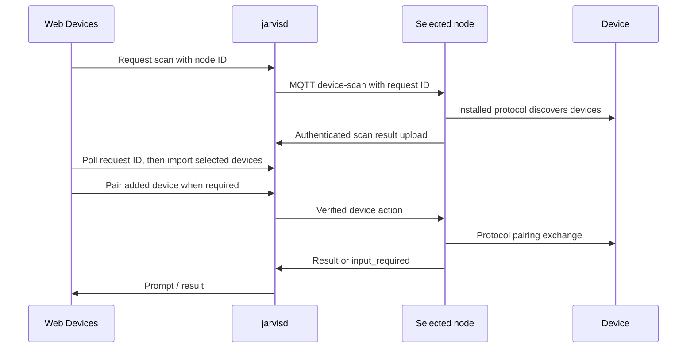

# Devices in the member web app

**Status:** Approved for implementation, 2026-11-10. Baseline source checked at server
`4ab4dec3`; the [implementation plan](02-devices-plan.md) tracks delivery and verification.

## Objective and scope

Every signed-in household member can open **Devices** alongside Chat, Recordings and
Workflows, discover supported smart-home devices through a household node, add them to
Jarvis and complete any required pairing. Users can do this from a browser away from home:
the chosen node must reach the devices; the browser only needs to reach jarvisd.

The user's request supersedes the Devices exclusion in
[the original member web app plan](01-member-web-app-plan.md). “All users” means every
household role, within the selected household. Jarvis computers and Pis remain in Add-ons
and the administrative Nodes page; this tab is for the devices they discover.

**First-version boundary:** use protocols already installed and configured on
the node. Pantry installation, credential entry and provider OAuth remain in their
existing surfaces. No new network scanner, protocol implementation or browser-to-node
listener is needed.

## Architecture and baseline findings



- Mobile already uses this request/poll/import/control flow in
  `jarvis-node-mobile/src/api/smartHomeApi.ts`, `DeviceDiscoveryScreen.tsx` and
  `DeviceEditScreen.tsx` (the screens live under `src/screens/SmartHome/` and
  `src/screens/Devices/`). These are behavior references in a separate repo.
- Server endpoints and household checks live in
  [smarthome.go](../../internal/modules/cc/smarthome.go),
  [smarthome_jobs.go](../../internal/modules/cc/smarthome_jobs.go),
  [smarthome_devices.go](../../internal/modules/cc/smarthome_devices.go) and
  [smarthome_control.go](../../internal/modules/cc/smarthome_control.go).
- Go owns MQTT/result uploads; the Python package sidecar loads Pantry device protocols
  and managers. [Desktop agents support this too](../decisions/2026-10-26-devices-on-desktop-agents.md).
  A scan runs configured protocols, which may discover LAN devices or use an already
  authorized cloud integration. It is not an exhaustive scan of every host on the subnet.
- The web [gateway](../../internal/modules/admin/gateway.go) exposes node listing and
  smart-home config to members at the baseline, but lacked device/scan routes. Add explicit
  member pass routes using the caller's JWT; retain CC's household checks and credential
  stripping. This is a server access change, subject to the repo's review hold.
- **At the baseline, node selection was not durable for a device.** Imports did not
  store the scan's node ID. `pickDeviceNode` previously chose a node on each control/state
  request using protocol or manager, the primary node and heartbeat recency. Pairing sessions live in the sidecar's
  persistent event loop. A different node or a restarted sidecar cannot finish that session.
  The routing contract below addresses this for server-routed requests; a UI-only port
  could not promise reliable pairing across multiple nodes or networks.
- Scan responses do not describe which protocols are missing, unconfigured or failed.
  A protocol failure may be omitted while other results succeed. An empty result cannot
  prove that the network has no devices. The node picker response also lacks protocol
  readiness details; do not invent a “ready” indicator from node online status.

## User flow

### Devices page

- Route `/devices`, in the existing member navigation, available to members, power users,
  household admins and superusers. Use the active-household context and explicit household
  scoping even for a superuser. With no household selected, show a selection prompt.
- Show saved devices with name, room (including Unassigned), type and protocol/source.
  Include search and an **Add devices** action. Reuse the SPA's loading, empty and error
  states. A saved row is evidence of registration, not proof the device is online or paired.
- A device detail view supports renaming, assigning an existing room, explicit removal
  from Jarvis, and pairing status/retry. Removal confirms the action and must not claim to
  factory-reset the physical device. Room creation/hierarchy editing and a full collection
  of per-domain control panels are outside this first version.

### Select a node and scan

- Default to the household's online primary node, then the first online household node.
  Show its name and offer a picker before scanning; selecting a node does not change the
  household primary. Include desktop agents and Pis. Disable offline choices. With no
  online node, explain what is needed instead of submitting a scan that will time out.
- State “Scan using [node]” and explain that discovery runs on that node's network with
  its installed integrations. Do not automatically scan on opening the Devices page.
- One active scan per page. Poll by its node/request pair, with a bounded wait consistent
  with the existing two-minute server job expiry. Distinguish pending, completed, failed,
  expired, unauthorized and transient connection errors. Do not retry authorization failures.
- Closing discovery, starting another scan, switching household/node or leaving the page
  stops polling and ignores late responses. There is no server cancellation endpoint:
  closing the view does not promise that the node's in-progress scan has stopped.
- Show discovered name, type, protocol and useful manufacturer/model details. Mark the
  server's `already_registered` results as already added; leave them unselected and link
  to the existing record. Do not silently merge different identities in the browser.
- Start with nothing selected. Allow selecting several new devices, editing their display
  names and assigning existing household rooms before **Add selected**. An empty scan
  explains that the integration may need installation/configuration, the device may need
  discovery mode, or a different node may reach it. Offer retry and node selection.

### Add, then pair

- Import selected devices through the existing registry API with `source: 'direct'` and
  the scan's identity fields. The server's import default is `home_assistant`, so the
  client must supply the source. Respect server validation and the created/updated counts;
  refresh the registry to obtain IDs. Refresh before retrying an ambiguous import timeout.
- Adding and pairing are distinct. A device requiring a code remains saved if pairing is
  cancelled or fails, with a retry affordance. Do not show “Paired” merely because import
  or an HTTP request succeeded.
- Read live state for a device being paired. Honor `state.needs_pairing`, the
  `ui_hints.control_type == 'pairing'` hint, and advertised pairing actions. Do not assume
  every device needs pairing or hard-code a supported-manufacturer list in React.
- Use the existing control action flow (`pair_start`, then the returned
  `input_required.follow_up_action` and opaque `session_id`). Render the supplied prompt
  as plain text. Follow repeated input requests until completion or failure. PIN entry
  preserves leading zeroes and separators; the existing follow-up uses `data.pin`.
  Other SDK input types (`text`, `confirm`) need a verified adapter payload convention
  before being offered; an unsupported prompt must produce a clear recoverable message.
- Pairing HTTP timeouts must exceed the server's 20-second pairing wait (use at least
  30 seconds); copying mobile's current 15-second control timeout would be incorrect.
  HTTP 200 can contain `success: false` or `input_required`; inspect the body.
- Keep PINs and pairing session data in memory, clear them on close/logout/household
  change, and exclude them from logs, URLs, persistent storage and error reporting.
  After success, refresh state before presenting the device as ready. If state refresh
  fails, report the pairing result separately from the unavailable live status.

### Stable routing requirement

The selected discovery node must remain usable for initial pairing and subsequent state
checks, and credentials stored on a node must not be assumed to exist on another node.
All steps of an active pairing must reach the node that started it. An offline node or a
lost sidecar session produces a retry/restart result, never silent rerouting of the PIN.

Import now accepts optional top-level `node_id`, validated against the household and
persisted for direct devices. Registry responses include nullable `node_id`. Re-imports
cannot move it; an older import without it preserves the binding and may only reuse
identical connection fields. A mismatching connection returns 409. A matching explicit
node may refresh connection fields. Existing unbound devices keep the earlier selection
rules until a node accepts their pairing start.

Pairing prompts create a bounded (1,024 entries), five-minute, in-memory binding to
household/device/user/node/session/follow-up action. An answer consumes it once; repeated
prompts can create a new step. Restart requires starting again. Control input cannot
replace stored identity fields. Missing/offline bound nodes return 503 without fallback.
Removal uses the bound node for best-effort cleanup but still removes its registration
if that node is unavailable; it cannot guarantee that physical credentials were erased.

These guarantees cover server-routed control, state and removal, including web/mobile
pairing. Existing node-local voice caches can still dispatch directly. Updating those
Go/Python client paths is separate work; keep the household-wide registry visible for
remote display/media selection. This feature makes no claim to migrate local voice
routing or credentials between nodes.

### Existing external-device mode and setup

Read `use_external_devices`. For an external-manager household, use the existing
node `device-list` request/poll flow and show the manager's devices without silently
importing, duplicating or switching the household to direct mode. Preserve the list's
editability/source information; this version provides a read-only manager list with
guidance to the existing manager setup surface. Direct scan/import is offered in direct
mode. Full external-manager onboarding/control is outside this feature.

For missing protocols or credentials, offer a working setup path appropriate to the
current user's access: the existing Store for superusers, and guidance to mobile/setup
or the household administrator for members. Never link a member to a forbidden admin
screen, auto-install a package, enable Pantry or initiate cloud authorization on a scan.

## Existing APIs to expose through the web gateway

Paths below are relative to `/api/cc/api/v0`; the gateway forwards to CC's `/api/v0`.
All new gateway registrations use `tierUser`, with authorization enforced again in CC.

| Method and path | Purpose |
| --- | --- |
| `GET /households/{hh}/smart-home/config` | Existing member route: mode, primary node and node options |
| `GET /households/{hh}/rooms` | Room choices |
| `GET /households/{hh}/devices` | Saved registry |
| `POST /households/{hh}/devices/import` | Add selected devices |
| `PATCH /households/{hh}/devices/{id}` | Rename / room assignment |
| `DELETE /households/{hh}/devices/{id}` | Remove registration |
| `GET /households/{hh}/devices/{id}/state` | Live state and pairing hints |
| `POST /households/{hh}/devices/{id}/control` | Pair and submit requested input |
| `POST /nodes/{node}/device-scan/request` | Start scan |
| `GET /nodes/{node}/device-scan/{request}` | Poll scan |
| `POST /nodes/{node}/device-list/request` | External-manager list |
| `GET /nodes/{node}/device-list/{request}` | Poll manager list |

Expose only these user operations, not node-authenticated result uploads, reset, package
installation or a wildcard CC proxy.

## Source layout and conventions

Use React 19, TypeScript, React Query, React Router and the existing Tailwind design tokens.
Files: `web/admin/src/pages/DevicesPage.tsx`, `api/devices.ts`
and focused `components/devices/` components. Wire `routes.tsx` and
`components/layout/Sidebar.tsx`. Keep tests beside the UI code, Go tests beside the CC/admin
handlers, and browser cases under `e2e/web/` with an entry in `e2e/coverage.json`.

Reuse the typed API-client style in [api/chat.ts](../../web/admin/src/api/chat.ts):

```ts
const CC = '/api/cc/api/v0'

export async function listDevices(householdId: string): Promise<Device[]> {
  const { data } = await apiClient.get<Device[]>(
    `${CC}/households/${encodeURIComponent(householdId)}/devices`,
  )
  return data
}
```

Use household/node/request IDs in query keys; discard stale mutations and prompts across
household changes. Reuse existing PageHeader, List, dialog, Button, EmptyState and
ErrorState components. Follow [the UI guide](../../web/admin/CLAUDE.md), keyboard/focus
behavior, labeled controls, reduced motion, and phone/tablet/desktop light/dark layouts.

## Acceptance and verification

1. Every household role sees Devices; anonymous users cannot use it. Cross-household
   IDs, requests, rooms and pairing sessions are refused at the server boundary.
2. A member chooses an online Pi or desktop, scans using a fake installed protocol,
   imports a selection and sees saved names/rooms after a reload and in the mobile API.
3. Already-added results do not create duplicates; invalid rooms are refused and the
   server disambiguates duplicate names with numeric suffixes. A repeated/ambiguous import is reconciled safely.
4. No-pairing devices and PIN-pairing devices both work. Wrong PIN, further prompts,
   cancellation, timeouts and sidecar restart leave recoverable states without false success.
5. With two eligible nodes, changed heartbeat order and a different household primary,
   scan/import/pair/state obey the stable-routing requirement. A disappearing pairing
   node never causes its follow-up to be sent to a different node.
6. No nodes, offline nodes, empty results, failing protocols, expired jobs and unavailable
   MQTT have useful states. Leaving or switching context cannot display stale results or
   submit a mutation into another household. External mode does not hide its manager list
   behind an empty direct registry.
7. The UI is keyboard usable and responsive in both themes; no PIN/session is persisted
   or logged. Existing chat, mobile APIs and node contracts continue to work.

Use TDD for implementation. Vitest/Testing Library cover the UI transitions; Go module
tests cover access and routing, including the three required tier gates; Playwright plus
a sandbox node/fake protocol proves the full member flow. Retain the workspace's 80%
coverage target and stricter existing checks. Hardware pairing is separate evidence:
do not claim manufacturer compatibility from a fake protocol test.

Run from the server checkout:

```bash
npm --prefix web/admin ci
npm --prefix web/admin test
npm --prefix web/admin run lint
npm --prefix web/admin run build
CGO_ENABLED=1 mise exec go@1.27 -- go test -race ./internal/modules/cc ./internal/modules/admin
scripts/check --all
scripts/e2e web --name web-devices-spec
scripts/sandbox up --name web-devices-spec --llm scripted --ui
scripts/screenshots --sandbox web-devices-spec
scripts/sandbox down --name web-devices-spec --purge
```

Follow the wire-change skill and contract guide if routing requires API additions.
Review screenshots using the UI guide's design audit. Clean up the task's sandboxes,
reports and temporary builds; use normal shared caches.

## Boundaries and review

- **Always:** reuse node protocols and CC transports, preserve household isolation,
  follow the source guides and existing SDK contracts, and make failures recoverable.
- **Review before landing:** the member gateway additions and any routing/auth changes,
  as required by [AGENTS.md](../../AGENTS.md).
- **Never:** scan from the browser/server host, add a node listener, expose node credentials,
  log pairing input, silently enable cloud integrations, change the primary node, or test
  against production or someone's real devices without authorization.

Text/confirmation payload conventions remain deferred until verified against adapters.
